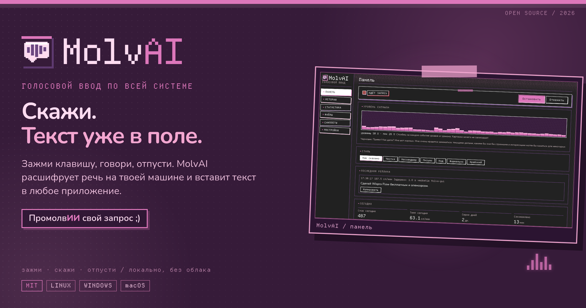
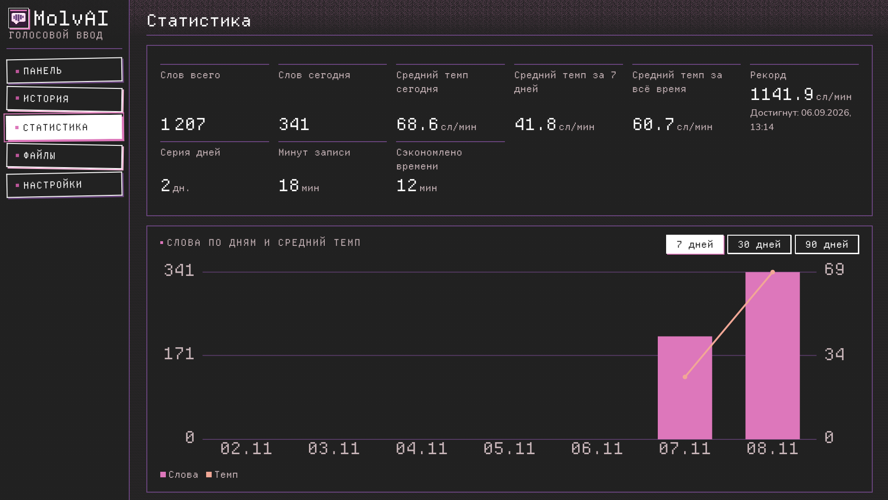
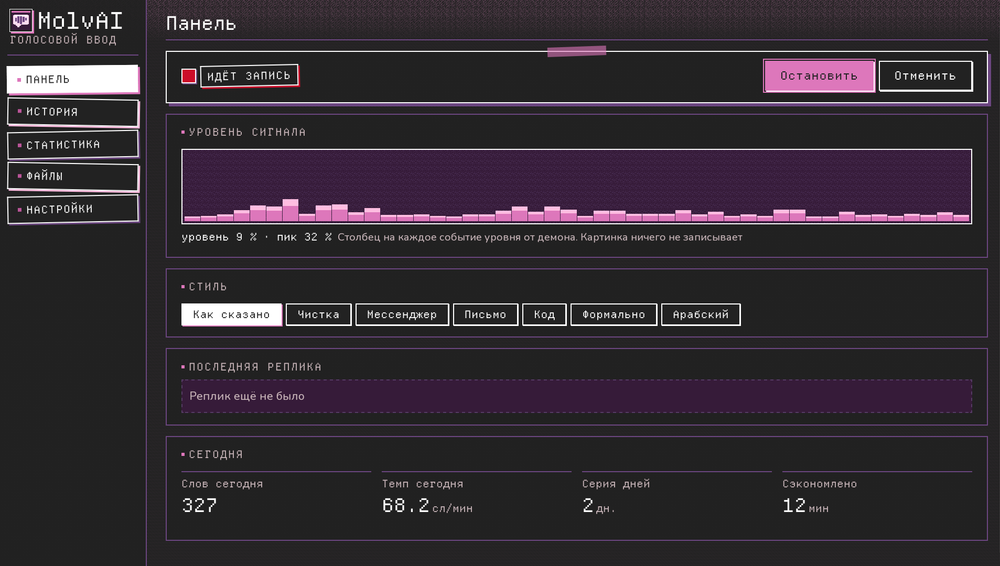
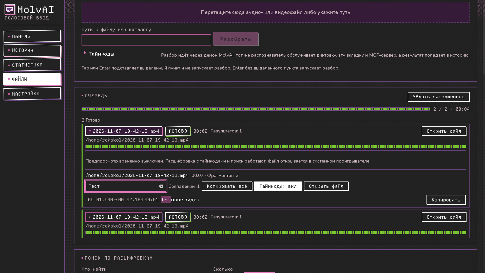

# MolvAI

[](https://github.com/rokokol/MolvAI/actions/workflows/build.yml)
[](https://github.com/rokokol/MolvAI/actions/workflows/deny.yml)
[](LICENSE)



System-wide voice input that runs on your computer: hold a key, speak, release, and the text appears in the active field of any application. Russian speech uses the Sber GigaAM-v3 model by default, at the same Q4_K_M quantization as the agent on the station, and the model is fast enough on a processor for speech to be typed while you are still talking

> [!NOTE]
> MolvAI started at the V0ICE hackathon in Kazan and is in development. What works and what is cut is in [docs/STATUS.md](docs/STATUS.md), and the external defects the code works around are in [WORKAROUNDS.md](WORKAROUNDS.md)

## What it does

- **Dictation anywhere**: the text goes to the active window through the keyboard or the clipboard, and the method is chosen by the application
- **Real-time chunks**: a phrase is cut at pauses during the recording, each chunk is recognized at once for the draft, and the text reaches the field as one piece after the key release
- **Voice editing**: select text, say "make it more formal", and the answer replaces the selection
- **Snippets**: a phrase such as "reply to a client" returns a prepared reply at once. A `*` in the phrase matches any text, the whole phrase must match after the dictionary and the rules, and the replacement bypasses the model entirely
- **Audio and video to text**: the Files tab hands a file to the daemon over IPC, and the daemon recognizes it with the recognizer and the model that dictation already holds; `molva transcribe` stays the standalone entry for an offline batch and prints timecodes
- **Search over transcripts**: `molva search` and the search inside the Files tab find a phrase across every transcribed file and show the file and the timecode
- **Local by default**: recognition, the dictionary, the rules and the journal stay on your computer; a language model is optional and works through any OpenAI-compatible API
- **Declarative on NixOS**: the Home Manager module renders settings and model weights into the Nix store, so a switch is the only way to change them and the GUI has no settings page to drift from the config

More about the arrangement: [docs/ARCHITECTURE.md](docs/ARCHITECTURE.md). The journal schema: [docs/journal-schema.md](docs/journal-schema.md)

## What it looks like

| The statistics                                                                             | Recording is on                                                                                                            |
| ------------------------------------------------------------------------------------------ | -------------------------------------------------------------------------------------------------------------------------- |
|  |  |

The panel shows the daemon state, the live signal level, the style, the last phrase with its pace and the statistics for today. The History, Files (with transcript search) and Stats tabs read the same journal as the CLI



## Installation

The shortest way is to ask an agent: open the repository in an agent with terminal access and say "read docs/install.md and install MolvAI". The guide asks for the system, the session and the sound server, and installs nothing without consent

### With Nix

```sh
nix run github:rokokol/MolvAI -- --help
```

With Home Manager, the flake's module installs `molva`, runs the daemon as a user service, writes the settings and fetches the weights into the store. On NixOS the default model is GigaAM-v3 e2e RNNT Q4_K_M, and the module also supplies the `transcribe-cli` runtime that loads it

```nix
# flake inputs: molvai.url = "github:rokokol/MolvAI";
imports = [ inputs.molvai.homeModules.default ];

programs.molvai = {
  enable = true;
  model = "gigaam-v3-e2e-rnnt-q4_k_m";
  models = [ "gigaam-v3-e2e-rnnt-q4_k_m" "small" ];
  # Any TOML of `molva config export`, merged over the generated defaults
  settings.stt.chunk_pause_ms = 500;
};
```

`programs.molvai.models` names entries from [models.toml](models.toml), the single catalog that both the CLI and the flake read. An unknown name fails the switch instead of falling back silently. `programs.molvai.modelsDirectory` replaces the fetched weights with a directory you own, `transcribeCli` replaces the GigaAM runtime, and `daemon.enable` and `hyprland.enable` turn the service and the binds off

The generated config lives at `$XDG_CONFIG_HOME/molva/config.toml` as a symlink into the store. It is read-only: the GUI hides the settings tab and `molva config set` refuses with a message that names `programs.molvai`. To change a setting, edit the Nix configuration and run `switch`

Under Hyprland with `wayland.windowManager.hyprland.configType = "lua"`, the module generates `~/.config/hypr/molvai.lua` in the store and links it into place. It does not edit `hyprland.lua`: the GUI help shows the one line to add, and the file stays yours

```lua
dofile(os.getenv("HOME") .. "/.config/hypr/molvai.lua")
```

### Without Nix

```sh
git clone https://github.com/rokokol/MolvAI && cd MolvAI
./install.sh --check   # what is missing and the exact commands for your distribution
./install.sh           # the binary goes to ~/.local/bin, no administrator rights needed
```

The script installs nothing itself: it prints the commands for Debian, Fedora, Arch, openSUSE, macOS and Windows, and a person makes the decision. Ready builds for Linux, Windows and macOS are on the [releases page](https://github.com/rokokol/MolvAI/releases): the CLI archive, AppImage, deb, dmg and the Windows installer, each with a SHA-256 sum. The Linux and Windows builds compute whisper on the video card through Vulkan and fall back to the processor without a Vulkan device. Optional CUDA archives for Linux and Windows carry the NVIDIA runtime separately

The default GigaAM weights run through `transcribe-cli` from [transcribe.cpp](https://github.com/handy-computer/transcribe.cpp). The Nix module supplies it. On another system, install `transcribe-cli` and put it on `PATH`, or run whisper instead:

```sh
molva config set stt.engine whisper-cpp
molva config set stt.model small
molva models pull small
```

The AppImage carries update information and a `.zsync` index, so AppImageUpdate can move it to the next release without downloading the whole image

### Removal

```sh
./install.sh --uninstall               # asks about the journal and the settings
./install.sh --uninstall --purge       # remove together with the history
./install.sh --uninstall --keep-history
```

## Quick start

```sh
molva doctor                 # session, paste tools, permissions, daemon, weights and provider
molva models pull gigaam-v3-e2e-rnnt-q4_k_m
molva devices                # microphones
molva daemon                 # the process that owns the microphone and the model
molva test-inject            # check that text reaches the active field
molva status                 # daemon state
```

`molva doctor` names the missing piece and the command that fixes it. If the daemon is not running, `molva record start` exits with code 3; the GUI starts the daemon itself

## The daemon

One process holds the microphone, the recognizer and the model. `molva daemon` starts it, and the socket and the settings file are the same for every client, so the CLI, the GUI and the MCP server share one recognizer instead of loading a model each

The GUI starts the daemon when a recording or a file needs it and nobody answers on the socket. It waits up to three minutes, because a clean machine also downloads the weights, and a daemon that dies before the socket shows its last line in the panel. Quit stops only the daemon that the window started itself: a process started by the Home Manager service or by hand keeps running, and the next window reuses it

### A file while a phrase is being dictated

File transcription is an IPC request (`file.transcribe`), not a second process. The daemon reads the file with the recognizer it already holds: the same model, language, dictionary and rules as dictation. `molva transcribe` remains only the standalone CLI entry for offline batched use: it loads its own engine, talks to no daemon and fits a script or CI

A file job does not move the state machine. It sets `job = "file"` while the state stays `idle`, and `molva status` and the panel read that as "transcribing a file". A recording during a file is accepted and queued behind it, then processed right after, because the audio cannot be repeated

A file is refused with `busy` while a phrase records or processes. The CLI turns that answer into exit code 4, and `molva transcribe` does not go through the daemon at all. The GUI keeps asking for up to half an hour, so a person who happens to dictate does not lose the file, and the MCP server waits thirty seconds before it reports the refusal. One recognizer transcribes one file at a time, so a second file waits for the first

## Audio and video to text

```sh
molva transcribe lecture.mp4 --timecodes
molva transcribe recordings/ --recursive --timecodes -o transcripts/
molva transcribe talk.mkv --json --copy
molva search "нейронные сети" --limit 10
```

`--timecodes` prints one segment per line as `[MM:SS.mmm → MM:SS.mmm] text`. `--json` always carries the segments, so the GUI and an MCP client get the same structure as the CLI. `--copy` puts the rendered result in the clipboard and leaves it there. The result is written to the journal, so `molva search` finds it later by text, file and timecode

Video is read through its audio track. MP4 and M4A use the built-in decoder; Matroska, WebM, MOV and AVI go through `ffmpeg` when it is installed. A missing `ffmpeg` gives an error that names the container, not a silent skip

In the GUI, the Files tab accepts a path or a drag-and-drop and sends it to the daemon, shows every segment with its timecode, and copies with or without timecodes; a timecodes button hides them in the list and in the copy. The same tab searches the transcripts of files, shows the file and the timecode, and copies a hit; the old separate Search tab is gone

Media preview and the audio spectrogram are temporarily off: WebKit and GStreamer hung the window. The transcript, the timecodes, the search, the copy and opening the file in the system player still work. The queue and the loaded history persist, so leaving the tab and returning does not clear them, and a completed job survives a window restart

## Models

The catalog is [models.toml](models.toml); `molva models list` shows what is in it and what is on disk. Each file is checked against its SHA-256 before it reaches the disk, and an interrupted download resumes with a `Range` request

| Model                       | Engine           | Language     | Size    | When to choose it                                              |
| --------------------------- | ---------------- | ------------ | ------- | -------------------------------------------------------------- |
| `gigaam-v3-e2e-rnnt-q4_k_m` | `transcribe-cpp` | Russian      | 175 MiB | the default: cased and punctuated Russian, fast on a processor |
| `small`                     | `whisper-cpp`    | multilingual | 465 MiB | English, mixed speech, or a machine without `transcribe-cli`   |
| `large-v3-turbo`            | `whisper-cpp`    | multilingual | 1.5 GiB | the most accurate whisper option, needs more memory            |

`stt.engine = "auto"` follows the catalog: the model says which runtime can load it, so choosing GigaAM does not require knowing that it is not a whisper file. A custom `stt.model_path` points at a directory with the weights; the catalog decides the file name inside it

The weights are not part of the repository, and the project license does not cover them. Their terms are in [docs/model-licenses.md](docs/model-licenses.md), and every address the program can call is in [docs/outgoing-endpoints.md](docs/outgoing-endpoints.md)

## Real-time dictation

Live typing while you speak is disabled in this build. The phrase is recognized as chunks for the draft, but the text reaches the active field as one piece after the key release; the same whole phrase is what the model sees for post-processing. This removes the ordering and duplication problems that the per-chunk path showed

`stt.streaming_preview` keeps the draft in the panel, `stt.chunked = false` turns chunk recognition off, and `stt.chunk_pause_ms` changes the pause that cuts a chunk. `stt.streaming_inject = false` is the shipped default; live chunk typing has its own roadmap item

## Hotkeys

The defaults are deliberately simple, so that they work on a foreign stand: hold `F9` to dictate, `Ctrl+Alt+Z` toggles, `Ctrl+Alt+X` edits the selection, `Ctrl+Alt+C` cancels, `Ctrl+Alt+S` changes the style. A short tap of the hold key latches the recording

On Hyprland the binds come from `molva setup hyprland --write`; on GNOME and KDE you attach `molva record start` and `molva record stop` to a custom shortcut; on Windows and macOS the application registers the combination. [docs/hotkeys-wayland.md](docs/hotkeys-wayland.md) has the details

## Privacy

The principle is simple: you control the microphone, not the program. Data does not go to the network without your knowledge

The microphone stream opens at the key press and closes right after the release. Outside a recording, MolvAI listens to nothing, and the system recording indicator is off. The close does not depend on how the phrase ended: a cancel, an error and an abnormal exit all release the stream, and the journal records the delay from the key release to the close

The journal is a local JSONL file. Its texts can be encrypted with XChaCha20-Poly1305, the key can live in the OS store, and `privacy.no_record_mode` turns the journal off completely. There is no telemetry

## Language model

The language model is off by default and works through any OpenAI-compatible API. It is called only for phrases longer than `rules.llm_min_words` words and only by styles that need it; a failure returns the text after the rules instead of losing the phrase

A local model stays serial: one request at a time, because two at once answer slower and worse. A cloud provider answers up to four calls beside each other, and one executor holds that policy, so no stage decides on its own to wait beside another. The post-processing of a phrase runs on the daemon worker, and a style can ask the same model to translate the text

```sh
molva config set llm.enabled true
molva config set llm.base_url http://localhost:11434/v1
molva config set llm.model qwen3.5:4b
printf '%s' "$KEY" | molva secret set llm
```

By default the key never enters the settings file: `llm.api_key_source` chooses the OS store, a file next to the settings, or an environment variable. `molva secret status` shows which entries exist without printing them. The opt-in `plain` source keeps the key in the TOML file in clear text; the GUI marks it as unsafe

## Exit codes

| Code | What it means                                |
| ---- | -------------------------------------------- |
| `0`  | everything worked                            |
| `2`  | wrong arguments or an unknown name           |
| `3`  | the daemon is not running or does not answer |
| `4`  | the daemon is busy with the previous phrase  |
| `5`  | error of the recognition engine              |
| `6`  | could not read or write a file               |
| `7`  | the daemon is already running                |

## Settings

`molva config export` prints the full TOML with every key and its current value; `molva config get stt.model` and `molva config set stt.model small` read and change one key. An empty file is valid: a missing field comes from the defaults

On NixOS the file is generated by `programs.molvai` and is read-only. On another system it is `~/.config/molva/config.toml`, created at the first start, and a wrong value gives an error with the key and the file

The GUI settings page edits the same file. It covers the recognition provider, the model with its download state, one language field with a list for automatic detection, the input device with a retry when the daemon reports none, the key source of every secret, custom styles beside the built-in ones, a recorder for each hotkey and a section for the MCP server. The Snippets tab edits `[snippets]`: a phrase and the text that replaces it before the model runs; `*` in the phrase matches any text, and a search filters the cards

## MCP server

`molva mcp` speaks the Model Context Protocol over standard input and output: the MCP client starts the process itself, so there is no port, no URL and no autostart. The server exposes transcription, search, statistics, history, the model catalog and its own documentation; it does not read or write the settings

A transcription goes to the daemon: the server starts the daemon when nobody answers on the socket and reuses its recognizer and model, so an MCP call does not load a second copy of the weights. `mcp.enabled` gates the server, and the GUI settings page turns it off without touching the harness configuration

| Tool                 | What it returns                                                                                                                                   |
| -------------------- | ------------------------------------------------------------------------------------------------------------------------------------------------- |
| `transcribe`         | the text, segments with timecodes, language and duration of an audio or video file; an optional `model` overrides the configured one for this run |
| `search_transcripts` | hits with the file, the timecode and the matched text                                                                                             |
| `stats_summary`      | words, speed, latency and the count of MCP transcriptions                                                                                         |
| `history_list`       | journal entries filtered by text, application and time                                                                                            |
| `models_list`        | the catalog and the weights on disk                                                                                                               |
| `search_docs`        | hits in this README, `docs/` and the site pages: the path, title, language, a snippet and a URL; `lang` keeps one language                        |

`search_docs` reads an index that the build writes into the binary from those same files. So the documentation has one copy, and the call reaches no network. A page the site translates is indexed once per language. A build that carries no documents answers with an empty index, and `indexed` says how many pages it searched

An MCP transcription is a file in the journal with `source = "mcp"`, so search finds it and the statistics count it apart from dictation and from `molva transcribe`. History labels it MCP, while a file transcription keeps the Files label. Settings are not a tool: on NixOS they belong to `programs.molvai`, and elsewhere the user edits the file where they can see it

## Tests and development

```sh
nix develop                        # the toolchain and the system libraries
just check                         # fmt, clippy, dependencies, tests, SPDX, no stubs
just falsify                       # break each guarantee from tests/defects.sh and require the suite to notice
just flaky 10                      # ten runs: do the results differ on the same code
just doc                           # documentation without broken links
```

`just test` runs `cargo test --workspace --no-fail-fast` through `scripts/t.sh`, which reads the log even at exit 0. The tests need no microphone, model or network: fakes replace the hardware, and the fixtures are in `tests/fixtures`. The GUI crate needs the Tauri system libraries; without them, `cargo test -p molva-core -p molva` covers the rest

CI calls the same `just` recipes, so a green Actions run means the same as a green run on your machine

## Documentation

- [docs/install.md](docs/install.md): installation by an agent or by hand
- [docs/STATUS.md](docs/STATUS.md): what works, what is cut, and why
- [docs/ARCHITECTURE.md](docs/ARCHITECTURE.md): processes, layers and the phrase pipeline
- [docs/journal-schema.md](docs/journal-schema.md): the JSONL journal
- [docs/hotkeys-wayland.md](docs/hotkeys-wayland.md): Hyprland, Sway and X11
- [docs/model-licenses.md](docs/model-licenses.md): the terms of the weights
- [docs/outgoing-endpoints.md](docs/outgoing-endpoints.md): every network address
- [docs/uniqueness.md](docs/uniqueness.md): how the project differs from the studied analogues
