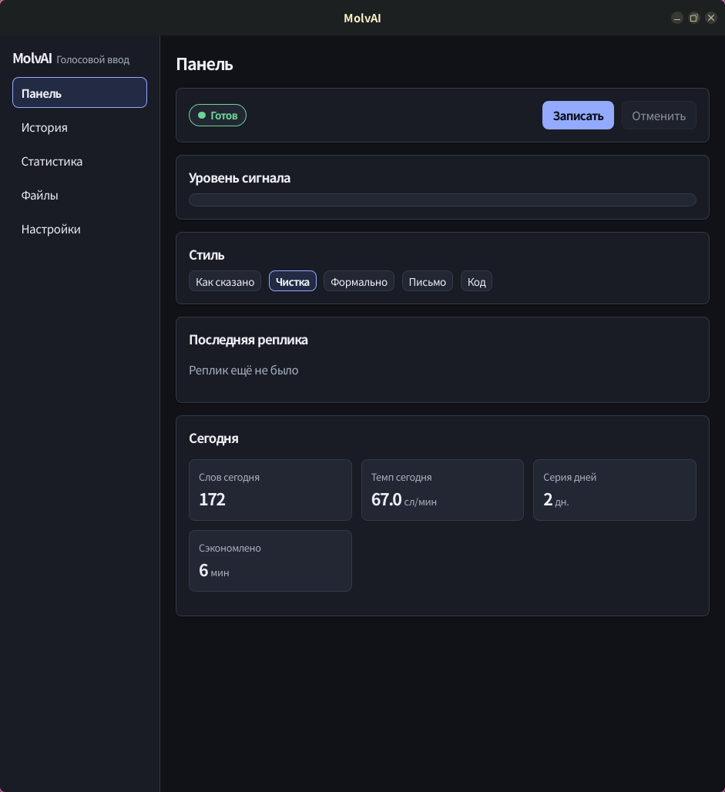
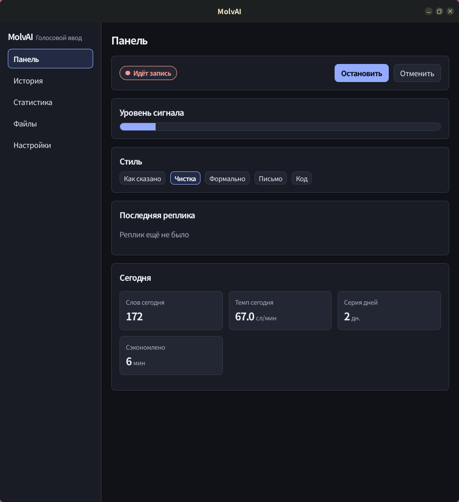
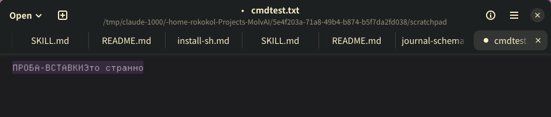
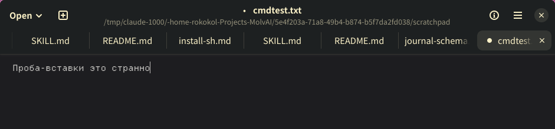

# MolvAI

[](https://github.com/rokokol/MolvAI/actions/workflows/build.yml)
[](https://github.com/rokokol/MolvAI/actions/workflows/deny.yml)
[](LICENSE)

Open system-wide voice input: hold a key, speak, release, and the text appears in the active field of any application. Processing runs on your computer, the same on Linux, Windows and macOS

> [!NOTE]
> The project is made at the V0ICE hackathon (Kazan, 5–6 September 2026) and is in development. What already works and what is cut is in [docs/STATUS.md](docs/STATUS.md). The README sections are filled in as the features appear

## How it works

- **Capture**: the microphone through `cpal`. The stream opens only for the time of the recording, and the audio is converted to mono 16 kHz
- **Recognition**: `whisper.cpp` locally (CPU, CUDA, Vulkan or Metal). A setting replaces the engine
- **Post-processing**: a term dictionary and rules without a model. If you want, a language model through any OpenAI-compatible API, Ollama by default
- **Paste**: keyboard emulation, or paste through the clipboard with its restoration. The method is chosen automatically and recorded in the journal

More details: [docs/ARCHITECTURE.md](docs/ARCHITECTURE.md). The phrase journal schema: [docs/journal-schema.md](docs/journal-schema.md)

## What it looks like

| The panel at rest | Recording is on |
| --- | --- |
|  |  |

The panel shows the daemon state, the live signal level, the choice of the processing style, the last phrase with its pace, and the statistics for today. The "History" and "Stats" tabs read the same JSONL journal as `molva history` and `molva stats`

## Installation

The shortest way is to ask an AI agent: open Claude Code in the repository directory and say "read docs/install.md and install MolvAI". The agent finds out your system, compositor and sound server, installs the dependencies, downloads the model and sets up the keys. [docs/install.md](docs/install.md) is written as a prompt for exactly this

### With one command

```sh
nix run github:rokokol/MolvAI -- --help                          # with Nix: build and run without cloning
git clone https://github.com/rokokol/MolvAI && cd MolvAI && ./install.sh   # without Nix: the binary goes to ~/.local/bin
```

Ready builds for Linux, Windows and macOS are on the [releases page](https://github.com/rokokol/MolvAI/releases): the CLI archive, AppImage, deb, dmg and the Windows installer, each with a SHA-256 sum in `sha256sums.txt`. The builds for Linux and Windows compute whisper on the video card through Vulkan, the same for NVIDIA, AMD and Intel, and without a Vulkan device they fall back to the processor by themselves. The build for macOS computes on the processor. The separate archive `molva-cuda-…-windows.tar.gz` is built with CUDA and carries the NVIDIA runtime (`cudart`, `cublas`), so it lies apart from the free packages. Replace `molva.exe` next to `MolvAI.exe` with it, and a phrase on an RTX 3060 is recognized in 0.5–0.9 s instead of 4 s

### With Nix

```sh
nix run github:rokokol/MolvAI -- --help   # build and run without cloning
```

```sh
nix develop                        # the toolchain and system libraries, nothing is installed in the system
cargo build --release --bin molva
./install.sh                       # the binary goes to ~/.local/bin, no administrator rights needed
```

### Without Nix

```sh
./install.sh --check   # what is missing and with which commands you install it on your distribution
```

The script installs nothing itself. It prints the exact commands for Debian, Fedora, Arch, openSUSE, macOS and Windows, and a person makes the decision. When you have installed the dependencies, run `./install.sh` again

### Windows

There is no `install.ps1` yet, and no stub in its place either. It is more honest to say it directly than to put in the repository a script that does nothing. Build with `cargo build --release --bin molva` and put `target\release\molva.exe` where you like, or take a ready archive from the releases page. The agent from [docs/install.md](docs/install.md) guides you through this step by step

> [!WARNING]
> The GUI packages from the release `v0.1.0` (`setup.exe`, `deb`, `AppImage`, `dmg`) install only the window, without the CLI, so when the window starts the daemon it asks you to build `molva`. The workaround: unpack the CLI archive for your OS from the same release and put `molva` (`molva.exe`) next to the application, on Windows usually `%LOCALAPPDATA%\Programs\MolvAI\`, or in a directory from PATH, then run `molva models pull small`. The next release carries the CLI inside the packages

### Removal

It removes exactly what was installed, by the manifest:

```sh
./install.sh --uninstall               # asks about the phrase journal and the settings
./install.sh --uninstall --purge       # remove together with the history
./install.sh --uninstall --keep-history
```

## Quick start

```sh
molva models pull small   # weights from Hugging Face, checked against SHA-256; without this step the daemon downloads them itself at the first start
molva doctor                 # session, paste tools, permissions, daemon, whisper weights and sha256, model provider
molva devices                # list of microphones
molva test-inject            # check that the text reaches the active field
molva daemon                 # the daemon that listens to the hotkeys
molva history paste --last   # paste the last phrase again, without dictating it
```

The hotkeys in Hyprland are lines in `~/.config/hypr/hyprland.conf`, where `bindr` fires on the release:

```
bind  = , F9, exec, molva record start
bindr = , F9, exec, molva record stop
bind  = CTRL ALT, Z, exec, molva record toggle
bind  = CTRL ALT, X, exec, molva record toggle --mode command
bind  = CTRL ALT, C, exec, molva record cancel
```

The hold and the toggle work at the same time and on the same settings. Hold `F9` and it records while you hold. Press the same key briefly and the recording latches and runs without the key until the next press. `Ctrl+Alt+Z` always starts and stops the recording by a press

> [!NOTE]
> The default combinations are deliberately not ergonomic: `F9` and `Ctrl+Alt` are free in almost any system and application, so on a foreign stand they work without setup. While the application is in testing, this matters more than comfort. You change the keys for your own hand in the `[hotkeys]` section

In GNOME and KDE, you attach the same commands to a custom combination in the keyboard settings. On X11 without a desktop environment, `sxhkd` fits. On Windows and macOS, the application itself registers the combination

## Microphone privacy

The microphone stream opens at the moment of the key press and closes right after the release. Outside a recording, MolvAI listens to nothing, and the recording indicator in the system is off

The release of the microphone does not depend on how the phrase ended. The stream closes on a cancel, on an error and on an abnormal exit of the daemon, because `CpalSource::release_microphone` is called from both `stop` and `Drop`

The daemon writes the measurement "from the key release to the stream close" to the log and to the field `latency_ms.stop_after_release` of each journal entry. So you can check the guarantee and do not have to take it on trust

## Exit codes

For scripts and compositor binds the code matters, not the text: `molva record start` in a bind shows no message to the user, but the script sees the code

| Code | What it means |
| --- | --- |
| `0` | everything worked |
| `2` | wrong arguments or an unknown name |
| `3` | the daemon is not running or does not answer |
| `4` | the daemon is busy with the previous phrase |
| `5` | error of the recognition engine |
| `6` | could not read or write a file |
| `7` | the daemon is already running: the second copy exited with a message |

## Settings

The file `~/.config/molva/config.toml` (on Windows and macOS, the matching settings directory of the user) is created at the first start and is readable by a human. An empty file is a valid config: any skipped field comes from the defaults, so it makes sense to keep in the file only what you changed

| Section | Key | Default | What it does |
| --- | --- | --- | --- |
| `audio` | `device` | `default` | a microphone from `molva devices` |
| `audio` | `gain` | `1.0` | gain of the input signal |
| `audio` | `max_duration_secs` | `600` | limit of the length of one phrase |
| `audio` | `trim_silence` | `true` | trim the silence at the edges of the recording |
| `audio` | `silence_threshold_db` | `-45.0` | the threshold below which the signal counts as silence |
| `audio` | `vad_min_pause_ms` | `1500` | a pause shorter than this does not cut the phrase |
| `audio` | `noise_suppression` | `false` | noise suppression |
| `audio` | `sounds` | `true` | sound marks of the start and the end of the recording; `false` means full silence |
| `audio` | `sound_volume` | `0.4` | volume of these signals, 0…1 |
| `audio` | `warn_zero_level` | `true` | warn about a zero signal level |
| `stt` | `engine` | `whisper-cpp` | `whisper-cpp` locally or `remote-openai` |
| `stt` | `model` | `small` | which weights to use |
| `stt` | `model_path` | empty | directory with the weights; empty means the default models directory |
| `stt` | `models_mirror` | empty | where to download the weights instead of Hugging Face: the address of a directory with `ggml-*.bin` files, and `http://` in a local network works too; the downloaded file is still checked against SHA-256 |
| `stt` | `language` | `ru` | an ISO-639-1 code or `auto`; automatic detection on CPU is several times slower |
| `stt` | `allowed_languages` | `["ru", "en"]` | among which languages to choose with `auto` |
| `stt` | `threads` | `0` | recognition threads; `0` means all logical cores |
| `stt` | `unload_after_secs` | `600` | after how long to unload the model from memory |
| `stt` | `no_speech_threshold` | `0.6` | the threshold above which a fragment counts as not speech |
| `stt` | `auto_pull` | `true` | the daemon downloads the weights itself at the start if they are missing, with progress in stderr and a SHA-256 check; `false` gives an error with the command `molva models pull` |
| `stt` | `chunked` | `true` | recognize the phrase in chunks right during the recording |
| `stt` | `chunk_pause_ms` | `700` | the pause at which a chunk goes to the model |
| `stt` | `streaming_preview` | `true` | show a draft of the recognized text during the speech |
| `dictionary` | `path` | empty | the term dictionary; empty means `dictionary.toml` next to the config |
| `dictionary` | `fuzzy` | `true` | fuzzy matching of terms |
| `dictionary` | `in_prompt` | `true` | pass the terms to whisper as a hint |
| `rules` | `enabled` | `true` | post-processing by rules at all |
| `rules` | `spoken_punctuation` | `true` | "запятая" ("comma") said aloud turns into a comma |
| `rules` | `auto_punctuation` | `true` | place the punctuation by itself |
| `rules` | `remove_fillers` | `true` | remove filler words |
| `rules` | `remove_repeats` | `true` | collapse repeats |
| `rules` | `numbers_as_digits` | `true` | numerals as digits |
| `rules` | `llm_min_words` | `10` | shorter phrases go through without a language model |
| `llm` | `enabled` | `false` | whether to call the language model at all |
| `llm` | `provider` | `ollama` | `ollama`, `lmstudio`, `openrouter`, `groq`, `openai` or `custom` |
| `llm` | `base_url` | `http://localhost:11434/v1` | address of the OpenAI-compatible API |
| `llm` | `model` | `qwen3.5:4b` | the post-processing model |
| `llm` | `api_key_env` | `OPENAI_API_KEY` | name of the environment variable with the key |
| `llm` | `api_key_source` | `keyring` | `keyring` is the OS store (Secret Service on Linux, Credential Manager on Windows, Keychain on macOS), `file` is `secrets/llm-api-key-<provider>` next to the settings, `env` is the environment variable only; the key is not in the settings file |
| `llm` | `timeout_secs` | `20` | how long to wait for the model answer; after that the text goes without it |
| `llm` | `max_retries` | `2` | retries of the request on a failure |
| `llm` | `reasoning_effort` | `auto` | `auto` sends `none` to local models and nothing to cloud ones; an empty string means do not send; any other value goes as it is. Reasoning models like qwen3.5 spend the whole token limit on reasoning without it and return an empty text |
| `style` | `default` | `cleanup` | the default text processing style |
| `style` | `by_app` | empty | window class → its own style |
| `output` | `mode` | `auto` | `auto`, `paste`, `type` or `clipboard` |
| `output` | `auto_type_max_chars` | `200` | above this length `auto` switches to the clipboard |
| `output` | `restore_clipboard` | `true` | return the previous content of the clipboard after the paste |
| `output` | `type_delay_ms` | `4` | delay between characters in input emulation |
| `output` | `pre_inject_delay_ms` | `50` | pause before the paste, so that the focus has time to return to the input field; on a remote desktop and in slow applications people set up to `1500` |
| `output` | `terminal_shortcut` | `true` | in terminals paste through Ctrl+Shift+V, and detect them by the window class |
| `output` | `notify_on_fallback` | `true` | tell when the paste method had to change |
| `hotkeys` | `backend` | `auto` | `auto`, `external`, `evdev` or `gui` |
| `hotkeys` | `push_to_talk` | `F9` | the hold key; the default combinations are simple on purpose, to work on any stand |
| `hotkeys` | `toggle` | `Ctrl+Alt+Z` | start and stop the recording by a press |
| `hotkeys` | `command` | `Ctrl+Alt+X` | command mode on the selection |
| `hotkeys` | `cancel` | `Ctrl+Alt+C` | cancel the recording without creating a phrase |
| `hotkeys` | `style_next` | `Ctrl+Alt+S` | the next style in a circle |
| `hotkeys` | `min_hold_ms` | `200` | a shorter hold does not create a phrase |
| `journal` | `enabled` | `true` | keep the phrase journal |
| `journal` | `include_text` | `true` | `false` means a journal line without the phrase text |
| `journal` | `encrypt` | `false` | `true` means the phrase texts in the journal are encrypted with XChaCha20-Poly1305; the other fields are open, and the statistics and filters work without the key |
| `journal` | `key_source` | `file` | where the encryption key lives: `file` is the file `key_path`, `keyring` is the entry `journal-key` in the OS store; it is created by itself at the first opening of the journal |
| `journal` | `key_path` | empty | the encryption key file with `key_source = file`; empty means `journal.key` next to the journal, created by itself with permissions for the owner only |
| `journal` | `max_entries` | `10000` | how many phrases to keep |
| `privacy` | `send_to_llm` | `true` | whether sending text to the language model is allowed |
| `privacy` | `no_record_mode` | `false` | turns off the journal and the history completely |
| `privacy` | `telemetry` | `false` | there is no telemetry; the key exists to state this explicitly |
| `autostart` | `enabled` | `false` | start at login |
| `gui` | `tray_animation` | `false` | `false` means the tray icon changes only when the state changes and does not blink on each event |
| `log` | `level` | `info` | `error`, `warn`, `info`, `debug` or `trace` |

The file edit applies without a rebuild, and a wrong value gives an error with the path to the file and the name of the key. The full list of fields is in `crates/molva-core/src/config.rs`

## Replacing the recognition model

A model is one weights file, and one setting changes it:

```sh
molva models list             # what is available and what is already downloaded
molva models pull large-v3-turbo
```

```toml
[stt]
model = "large-v3-turbo"
```

`base` is faster and clearly worse, `small` is the default compromise, and `large-v3-turbo` is more accurate and needs more memory. You connect your own weights through `stt.model_path`: any file in the `ggml` format that whisper.cpp understands fits

The weights are not part of the repository, and the license of the project does not cover them. Their terms are collected in [docs/model-licenses.md](docs/model-licenses.md), and the addresses they are downloaded from are listed in [docs/outgoing-endpoints.md](docs/outgoing-endpoints.md) together with all other outgoing connections

## Phrase language

By default the language is fixed: `stt.language = "ru"`. This is the fastest path: the model does not spend time on the choice of language, and English speech in this mode is written down in Russian

You turn on bilingual dictation like this:

```toml
[stt]
language = "auto"
allowed_languages = ["ru", "en"]
```

Then the language is detected from the first two seconds of the phrase and chosen **only** from `allowed_languages`: on a short Russian phrase whisper easily goes to Ukrainian or Bulgarian otherwise. On a processor with the `small` model this costs about two or three seconds per phrase, that is, plus half to the recognition time. But with `stt.chunked = true` the detection falls on the first chunk and happens while the person is still speaking

The language is chosen once per phrase and applies to all its chunks: whisper reads a fragment in one language anyway, so mixed speech inside one phrase stays in one reading. Latin insertions in a Russian phrase are recognized, but a whole English sentence in the middle of a Russian phrase is not

## Language model

By default only the dictionary and the rules edit the text, and the model is off. Two keys turn it on, and it works through any OpenAI-compatible API. It is checked on Ollama with `qwen3.5:4b`:

```sh
ollama pull qwen3.5:4b
molva config set llm.enabled true
molva config set style.default cleanup
```

The model is called only for phrases longer than `rules.llm_min_words` words and only for the styles that need it (`cleanup`, `messenger`, `mail`, `code`, `formal`). The `verbatim` style does not touch it. If the model does not answer, answers empty, or takes longer than `llm.timeout_secs`, the text after the rules goes to the field, and the phrase is not lost. The same chain works for files: `molva transcribe file.wav --style cleanup`, and `--no-llm` turns off the model for one run

The key of a cloud provider (Groq, OpenRouter, OpenAI) does not get into the settings file. With `llm.api_key_source = keyring` it lies in the OS store, with `file` in a file with permissions for the owner only, and with `env` in the variable `llm.api_key_env`. You store it through stdin, so that it does not stay in the shell history: `printf '%s' "$KEY" | molva secret set llm`. `molva secret status` shows which entries exist without printing the values, and `molva doctor` checks whether the store answers. If there is no entry or the store is unavailable, the key is read from the environment variable with a warning in the log

On an RTX 3060 the `qwen3.5:4b` answer for a phrase of ten words takes about a second. On CPU count on three or more. In the journal such a phrase has `llm_used = true`, the provider, the model, `latency_ms.llm` and the token count, so the cost of the model is visible in `molva stats`

> [!NOTE]
> Reasoning models (qwen3, qwen3.5, deepseek-r1) "think" aloud by default and with a small `max_tokens` do not reach the answer. MolvAI sends `reasoning_effort = none` to local providers, and the answer comes in a fraction of a second instead of an empty string. The key `llm.reasoning_effort` controls this

## Works offline

The network is needed exactly twice, and both times by an explicit command: `molva models pull` downloads the whisper weights from Hugging Face, and a cloud provider of the language model, if you chose it yourself instead of Ollama. Everything else works with the cable pulled out: capture, recognition, the dictionary, the rules, the paste, the journal, the statistics and the GUI. The tests do not go to the network either, and the full list of addresses that the program can call at all is in [docs/outgoing-endpoints.md](docs/outgoing-endpoints.md)

The limits without a network: you cannot download a new model, and the styles with a language model work only with a local provider (Ollama, LM Studio). When the provider is unavailable, the phrase is still pasted as the text after the rules

## The original feature

**Voice editing of the selected text.** Select any text in any application, press the command mode key, say what to do with it, and press again: "сделай официальнее" ("make it more formal"), "переведи на английский" ("translate to English"), "в маркированный список" ("into a bulleted list"), "короче вдвое" ("twice shorter"). The result replaces the selection in place, without copying to a chat with a model and back

How to reproduce it on Hyprland:

```
bind = SUPER ALT, C, exec, molva record toggle --mode command
```

1. `molva config set llm.enabled true` and a running Ollama with `qwen3.5:4b` (`molva doctor` shows both lines green)
2. Select a paragraph in an editor or a browser
3. Super+Alt+C, say "переведи на английский" ("translate to English"), Super+Alt+C again
4. After one or two seconds the paragraph is replaced by the translation. The source phrase and the result are visible in `molva history --limit 1`

| Before: the selected line | After: the selection replaced by the model answer |
| --- | --- |
|  |  |

What happens inside: the daemon copies the selection with the Ctrl+C combination through the compositor, recognizes the instruction, sends the model the selection and the instruction with the system prompt from `command_mode.system_prompt`, cleans the answer of service tags, and pastes it in place of the selection. The key `command_mode.enabled = false` turns it off. The mode does not affect the latency of normal dictation, because the model is called only by this key

The benefit in numbers: a voice edit of a paragraph of 60 words takes about 5 seconds together with recognition and the `qwen3.5:4b` answer on an RTX 3060. Retyping the same paragraph by hand at 40 words per minute takes 90 seconds, and copying to a chat with a model and back takes 20–30 seconds. The automatic tests: `command_mode_rewrites_the_selection`, `command_mode_without_a_selection_is_an_explicit_error`, `command_mode_without_a_model_is_an_explicit_error` in `crates/molva-core/src/app/pipeline.rs`

It works offline with a local provider. None of the 606 criteria of the hackathon checklist describes an edit of existing text by voice: they are about dictation of new text

## Tests

One command, plain Cargo, without Nix and without `just`:

```sh
cargo test --workspace --no-fail-fast
```

The tests need no microphone, no model and no network: fakes replace the hardware, and the audio comes from `tests/fixtures/`. The GUI crate needs the Tauri system libraries. If they are missing, check the core and the CLI separately:

```sh
cargo test -p molva-core -p molva --no-fail-fast
```

The system dependencies for a build on Debian and Ubuntu: `cmake libasound2-dev libxkbcommon-dev libwayland-dev` for the core and the CLI, plus `libwebkit2gtk-4.1-dev libgtk-3-dev libayatana-appindicator3-dev librsvg2-dev` for the GUI. `./install.sh --check` prints the full list for other distributions. The Rust toolchain is pinned in `rust-toolchain.toml`, and `rustup` picks it up by itself

The same run with an honest verdict (the log is read even at exit 0) and the other checks go through `just`:

```sh
just test     # cargo test through scripts/t.sh
just check    # fmt, clippy, dependencies, tests, SPDX headers, no stubs
just falsify  # break each guarantee from tests/defects.sh and require the suite to notice
```

## Development

```sh
nix develop   # the toolchain and system libraries
just check    # fmt, clippy, dependencies, tests, SPDX headers, no stubs
```

The tests go through `scripts/t.sh`, a harness from the [tests skill](https://github.com/rokokol/tests-skill): the run status is honest, and the log is read even at exit 0

```sh
just falsify        # break each guarantee from tests/defects.sh and require the suite to notice
just flaky 10       # ten runs in a row: do the results differ on the same code
just lint-deps      # cargo machete: dependencies that nobody uses
just doc            # documentation without warnings, a broken link is an error
just cov            # coverage in coverage.lcov
just deny           # licenses of the dependencies and vulnerabilities
just third-party    # rebuild THIRD-PARTY.md
just sbom           # bill of materials in the CycloneDX format
molva bench         # WER, CER and time on the fixtures from tests/fixtures
```

CI calls the same `just` recipes and not copies of their commands, so a green run in Actions means exactly the same as a green `just check` on your machine

How this project differs from the studied analogues and which code in it is borrowed: [docs/uniqueness.md](docs/uniqueness.md)
